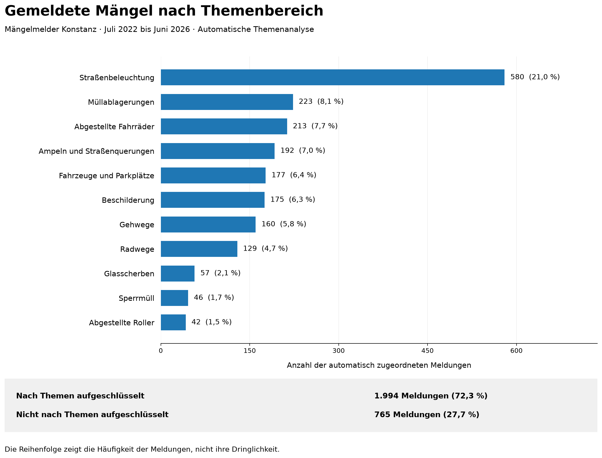

# Themenanalyse kommunaler Bürgerhinweise

Python-Projekt zur Analyse unstrukturierter Beschwerden und Hinweise aus dem Mängelmelder der Stadt Konstanz. Ziel ist es, die häufigsten Themen der Meldungen zu ermitteln und für Entscheidungstragende verständlich darzustellen. Dafür werden zwei Vektorisierungen (Count und TF-IDF) und zwei Verfahren der Themenmodellierung (LDA und NMF) mit scikit-learn verglichen. Die Ergebnisübersicht beruht auf NMF mit TF-IDF und 15 Topics.

Der Ablauf der Analyse liegt als Jupyter Notebook vor. Hilfsfunktionen und Wortlisten stehen unter `src/`. Die Ausgabe umfasst eine nach Häufigkeit sortierte Themenübersicht und ein Balkendiagramm mit matplotlib.

## Ergebnisse

Bei 36 der 2.795 Meldungen bleiben nach dem Text Preprocessing keine Wörter übrig. Die verbleibenden 2.759 Meldungen gehen in die Vektorisierung ein. Davon werden 2.731 einem der 15 Topics zugeordnet, während 28 keine Merkmale im verwendeten Vokabular enthalten. Elf Topics bilden die Ergebnisübersicht mit 1.994 Meldungen (72,3 %). Die übrigen vier Topics sind inhaltlich gemischt. Ihre 737 Meldungen werden zusammen mit den 28 Meldungen ohne Zuordnung nicht nach Themen aufgeschlüsselt, insgesamt 765 Meldungen (27,7 %). Alle 15 Topics enthält die Datei `ergebnisse/nmf_topics_beschriftet.csv`.



Die Dateien unter `ergebnisse/` sind ausgewählte Kopien des geprüften Durchlaufs. Neue Berechnungen werden unter `outputs/aktuelle_analyse/` gespeichert und ersetzen diese veröffentlichten Kopien nicht automatisch.

| Ausgabe unter `ergebnisse/` | Inhalt |
|---|---|
| [entscheidungstraeger_themenuebersicht.csv](ergebnisse/entscheidungstraeger_themenuebersicht.csv) | Elf Themen mit Rang, Häufigkeit, Anteil, Beschreibung und sinngemäßem Beispiel |
| [nmf_topics_beschriftet.csv](ergebnisse/nmf_topics_beschriftet.csv) | Alle fünfzehn Topics mit Bezeichnungen, wichtigen Begriffen, Häufigkeiten und Einordnung |
| [umfang_themenuebersicht.csv](ergebnisse/umfang_themenuebersicht.csv) | Anzahl und Anteil der aufgeschlüsselten und nicht aufgeschlüsselten Meldungen |
| [nicht_aufgeschluesselt_gruende.csv](ergebnisse/nicht_aufgeschluesselt_gruende.csv) | Aufteilung der übrigen 765 Meldungen in 737 aus uneinheitlichen Topics und 28 ohne Zuordnung |
| [modellauswahl.csv](ergebnisse/modellauswahl.csv) | Einstellungen und Kontrollzahlen der ausgewählten Analyse |
| [vergleich_verfahren_zusammenfassung.csv](ergebnisse/vergleich_verfahren_zusammenfassung.csv) | Kennzahlen der drei Konfigurationen einschließlich der Streuung bei LDA |
| [themenhaeufigkeiten_nmf.png](ergebnisse/themenhaeufigkeiten_nmf.png) | Balkendiagramm der elf Themen |

Die ersten vier CSV-Dateien in der Tabelle oben verwenden Semikolons als Trennzeichen und Dezimalkommas. Prozentanteile werden mit einer Nachkommastelle exportiert. Beim Einlesen mit pandas sind dafür `sep=";"` und `decimal=","` anzugeben. Die Dateien `modellauswahl.csv` und `vergleich_verfahren_zusammenfassung.csv` verwenden ebenfalls Semikolons, enthalten aber ungerundete Kennzahlen mit Dezimalpunkt. Für diese beiden Dateien wird nur `sep=";"` angegeben, ohne `decimal=","`.

Die Notebooks für die Vergleiche speichern ihre Ausgabe getrennt unter `outputs/bisherige_vergleiche/` und `outputs/ergaenzende_vergleiche/`.

## Hinweise zur Interpretation

Die Rangfolge zeigt die Häufigkeiten der dargestellten Themen und nicht die Dringlichkeit der Probleme. Jede zugeordnete Meldung zählt beim Topic mit dem höchsten positiven Koeffizienten. Bei NMF werden dafür die Topic-Vektoren auf die L2-Norm 1 gebracht und die Koeffizienten entsprechend angepasst. Die Dominanz beschreibt den Anteil des höchsten Koeffizienten an der Summe aller Topic-Koeffizienten einer Meldung. Ein Filter nach Dominanz wird nicht angewendet.

Die Prozentanteile beziehen sich auf alle 2.759 Meldungen nach dem Text Preprocessing. Die Themenbezeichnungen wurden anhand der Top-Begriffe, der Verteilung der Meldekategorien und ausgewählter Meldungen vergeben. Die Beispielsätze erläutern die Themen sinngemäß und sind keine Originalzitate. Weitere Meldungen zu einem Thema können auch anderen Topics zugeordnet sein, beispielsweise Glasscherben auf einem Radweg dem Topic „Radwege“. Die Häufigkeiten sind daher keine vollständige Fallstatistik.
   
## Funktionen

| Funktion | Umsetzung |
|---|---|
| **Data Profiling** | Analyse von Fehlwerten, Textduplikaten und der Verteilung der Textlängen mit `pandas` |
| **Text Preprocessing** | Bereinigung mit regulären Ausdrücken, Normalisierung von Schreibvarianten und Begriffen, Tokenisierung und Stoppwortfilterung mit `re` und `pandas` |
| **Vektorisierung und Themenmodellierung** | `CountVectorizer` mit LDA und NMF sowie `TfidfVectorizer` mit NMF in `scikit-learn` |
| **Modellevaluation** | Kohärenzbewertung mit `c_v` in `gensim`, Vergleich mit den Meldekategorien und qualitative Prüfung ausgewählter Meldungen |
| **Topic-Auswertung und Visualisierung** | Zuordnung zum Topic mit dem höchsten Koeffizienten, Berechnung absoluter und relativer Häufigkeiten, CSV-Export und Balkendiagramm mit `NumPy`, `pandas` und `matplotlib` |
| **Funktionstests** | 35 Tests mit `unittest` für Datenaufbereitung, Textnormalisierung, Topic-Zuordnung und Ergebnisdarstellung |

## Daten

Die Daten stammen aus dem [Open-Data-Portal der Stadt Konstanz](https://offenedaten-konstanz.de/dataset/m-ngelmelder), Ressource „Mängelmelder Konstanz (Stand: aktuell)“. Grundlage ist die Originaldatei `maengelmelder_konstanz_final_9.csv`. Für die Analyse wird die unten beschriebene bereinigte Kopie verwendet, ausgewertet wird die Freitextspalte `text_raw`.

Die vorhandenen Haupt- und Unterkategorien dienen ausschließlich zur Plausibilisierung der Ergebnisse und gehen nicht in das Modelltraining ein. Identische Texte mit unterschiedlichen Melde-IDs bleiben als einzelne Meldungen erhalten.

Die verwendete Ressource „Mängelmelder Konstanz (Stand: aktuell)“ ist unter [CC0 1.0](https://creativecommons.org/publicdomain/zero/1.0/) veröffentlicht.

### Bereitgestellte Daten

Die Datei `data/raw/maengelmelder_konstanz_final_9_bereinigt.csv` ist eine bereinigte Kopie der Originaldatei `maengelmelder_konstanz_final_9.csv`. Sie enthält weiterhin 2.795 Meldungen vom 26.07.2022 bis zum 02.06.2026 und alle zehn Spalten.

Die für diese Analyse nicht benötigten Inhalte von `responsible`, `lat`, `lon`, `address_input` und `detail_url` wurden geleert. Drei Signaturen mit Personennamen und ein Kfz-Kennzeichen in den Meldetexten wurden durch `[...]` ersetzt. IDs, Datumsangaben, Kategorien und die Reihenfolge der Meldungen bleiben unverändert.

Die Datei ist bereinigt, aber nicht anonymisiert, und die Originaldatei wird nicht mitveröffentlicht.

| Datei | SHA-256 |
|---|---|
| Originaldatei `maengelmelder_konstanz_final_9.csv` | `c8f789e551945f07d7b1ccc65c3bc39ab8e7e4fb436eeb7f2f58a6ed4b4fc6d7` |
| Bereinigte Kopie `maengelmelder_konstanz_final_9_bereinigt.csv` | `bd7057df23579df4302fea4a51302c9f6459a1624cee55e47cf331e117eae84c` |

Für die Reproduktion wird die mitgelieferte bereinigte CSV verwendet. Eine neuere Datei aus dem Open-Data-Portal kann unter `data/raw/` abgelegt und über `CSV_NAME` in Schritt 02 ausgewählt werden. Bei einem anderen Datenstand stoppt das Notebook vor der Beschriftung in Schritt 15. Die Themenbezeichnungen müssen dann anhand der neuen Ergebnisse geprüft und zusammen mit dem SHA-256 der neuen Datei in `src/result_view.py` hinterlegt werden. Andere Datensätze können zusätzlich Anpassungen an Spalten und Text Preprocessing erfordern.

## Modellvergleich

Die Ergebnisübersicht verwendet **NMF mit TF-IDF und fünfzehn Topics**. Die Texte werden dafür in Schreibweise und Wortform normalisiert. Mit `min_df=2` werden nur Begriffe berücksichtigt, die in mindestens zwei Meldungen vorkommen. Das Hauptnotebook vergleicht diese Konfiguration mit NMF auf Count-Vektoren und LDA auf Count-Vektoren. Alle Modelle verwenden dieselben bereinigten Texte und dasselbe Vokabular mit 2.460 Merkmalen.

| Konfiguration | Topics | Läufe | Kohärenz `c_v` | AMI Hauptkategorien | AMI Unterkategorien |
|---|---:|---:|---:|---:|---:|
| **NMF mit TF-IDF** | 15 | 1 | 0,4383 | 0,3047 | 0,4061 |
| NMF mit Count | 15 | 1 | 0,5451 | 0,3352 | 0,3952 |
| LDA mit Count | 10 | 5 | 0,3365 ± 0,0254 | 0,1778 ± 0,0143 | 0,2015 ± 0,0171 |

Die Kohärenz `c_v` bewertet den Zusammenhang der wichtigsten Begriffe innerhalb eines Topics (Röder et al., 2015). Die Adjusted Mutual Information (AMI) vergleicht die Topic-Zuordnungen mit den Meldekategorien. Dabei berücksichtigt sie die zufällig zu erwartende Übereinstimmung (Vinh et al., 2010).

Die Kategorienkennzahlen beziehen sich auf dieselben 2.731 Meldungen mit Topic-Zuordnung. Die NMF-Zeilen zeigen Seed 42. Bei LDA stehen Mittelwert und Standardabweichung über fünf Seeds bei jeweils 100 Iterationen. Die vollständigen Kennzahlen enthält die [Zusammenfassung des Verfahrensvergleichs](ergebnisse/vergleich_verfahren_zusammenfassung.csv).

Beide NMF-Varianten stimmen in diesem Vergleich stärker mit den Meldekategorien überein als LDA. Die Gruppierungen von LDA unterscheiden sich außerdem deutlich zwischen den Seeds (Schritt 11l). NMF mit Count erreicht die höhere Kohärenz und eine höhere AMI gegenüber den Hauptkategorien. Bei den Unterkategorien liegt dagegen NMF mit TF-IDF vorn (AMI 0,4061 zu 0,3952). Einzelne Count-Topics enthalten vorwiegend allgemeine Formulierungen wie „insbesondere“ oder „zudem“ und lassen keinen einheitlichen thematischen Schwerpunkt erkennen.

Um zu prüfen, ob die Zuordnungen inhaltlich passen, wurden die Anliegen von 50 zufällig ausgewählten Meldungen in eigenen Worten beschrieben. Anschließend wurden diese Beschreibungen mithilfe von ChatGPT mit den Topic-Zuordnungen beider NMF-Varianten abgeglichen. Bei NMF mit TF-IDF waren Anliegen wie Ampeln, Sperrmüll und abgestellte Roller klarer erkennbar.

Die folgenden Ergebnisse zur Topic-Anzahl und zum LDA-Training stammen aus Vergleichen, die noch mit der Originaldatei berechnet wurden. Die Kategorienkennzahlen beziehen sich auf dieselben 2.651 Meldungen, die in allen untersuchten Varianten einem Topic zugeordnet wurden. Die aktuelle Vergleichstabelle oben verwendet dagegen die bereinigte Kopie und alle 2.731 zugeordneten Meldungen.

Dies erklärt die unterschiedlichen AMI-Werte für die Unterkategorien. Bei NMF mit TF-IDF und 15 Topics liegt der Unterschied zwischen 0,4162 und 0,4061 allein an der Auswahl der ausgewerteten Meldungen, da die Topic-Zuordnungen unverändert sind. Bei LDA (0,2105 im Entwicklungsvergleich und 0,2015 in der aktuellen Tabelle) veränderte die Bereinigung zusätzlich einzelne Zuordnungen. Bei einer erneuten Ausführung der Vergleichsnotebooks mit der bereinigten Kopie können deshalb einzelne Werte von den dokumentierten Ergebnissen abweichen.

Die Wahl von 15 Topics beruht auf dem Vergleich der Topic-Anzahlen in [03_ergaenzende_vergleiche.ipynb](notebooks/03_ergaenzende_vergleiche.ipynb), Schritt 11j. Für NMF mit TF-IDF auf normalisierten Texten mit `min_df=2` ergaben sich folgende Werte:

| Anzahl Topics | Kohärenz `c_v` | AMI Unterkategorien |
|---|---:|---:|
| 6 | 0,4200 | 0,3873 |
| 8 | 0,4086 | 0,3849 |
| 10 | 0,4470 | 0,3906 |
| 12 | 0,4341 | 0,3983 |
| 15 | 0,4383 | 0,4162 |

Unter den untersuchten Topic-Anzahlen erreichte NMF mit TF-IDF und 15 Topics die höchste AMI für die Unterkategorien. Gleichzeitig ließen sich zusätzliche Anliegen wie Sperrmüll und abgemeldete Fahrzeuge getrennt abbilden. Beides sprach für 15 Topics, obwohl zehn Topics eine etwas höhere Kohärenz erreichten.

Die zehn Topics für LDA stammen aus dem Vergleich von 6 bis 15 Topics in [02_bisherige_vergleiche.ipynb](notebooks/02_bisherige_vergleiche.ipynb). Nach der erweiterten Textnormalisierung wurde die Topic-Anzahl nur für NMF erneut geprüft. Bei LDA konzentrierten sich die weiteren Untersuchungen auf Trainingsumfang und Initialisierung, dokumentiert in Schritt 11l von [03_ergaenzende_vergleiche.ipynb](notebooks/03_ergaenzende_vergleiche.ipynb).

Auch bei jeweils zehn Topics lag NMF mit TF-IDF bei den Unterkategorien vorn. Auf denselben 2.651 Meldungen erreichte NMF mit Seed 42 eine AMI von 0,3906. LDA mit Count erreichte bei 100 Iterationen im Mittel über fünf Seeds 0,2105. Beide Auswertungen verwendeten die normalisierten Texte mit `min_df=2`. Count und LDA bleiben als Vergleichsverfahren dokumentiert.

<details>
<summary>Ergänzende Modellvergleiche aus der Entwicklung</summary>

Die folgenden Untersuchungen sind in [03_ergaenzende_vergleiche.ipynb](notebooks/03_ergaenzende_vergleiche.ipynb) unter den Schritten 11g bis 11l dokumentiert. Für ihre Kategorienkennzahlen gilt der Hinweis oben zur Originaldatei und zur gemeinsamen Teilmenge von 2.651 Meldungen.


| Schritt | Untersuchung | Ergebnis |
|---|---|---|
| 11g | Gemeinsame Stichprobe | LDA und NMF wurden an denselben 100 Meldungen gegenübergestellt. Die Erstbewertung mit ChatGPT zeigte gemischte Topics und unpassende Zuordnungen. |
| 11h | Textnormalisierung und Vokabularfilter | Die Meldetexte verwenden ae, oe und ue statt Umlauten. Die Normalisierung von Schreibweisen und Wortformen zusammen mit `min_df=2` reduziert die Anzahl der Meldungen ohne Merkmale von 108 auf 28. Das Absenken von `min_df` allein bringt keinen durchgängigen inhaltlichen Vorteil. |
| 11i | Vergleich mit den Meldekategorien und Prüfung der Topic-Dominanz | Bei NMF mit TF-IDF und zwölf Topics steigt die AMI gegenüber den Hauptkategorien von 0,312 mit der bisherigen Textverarbeitung und `min_df=5` auf 0,329 nach Normalisierung der Schreibweisen und Wortformen mit `min_df=2`. LDA mit Count und zehn Topics erreicht auf denselben normalisierten Texten 0,192. Schwellenwerte von 0,4, 0,5 und 0,6 für die Topic-Dominanz wurden untersucht, aber nicht als Filter für die Ergebnisübersicht übernommen. |
| 11j | Anzahl der NMF-Topics | Verglichen wurden 6, 8, 10, 12 und 15 Topics auf normalisierten Texten, jeweils mit `min_df=5` und `min_df=2`. NMF mit TF-IDF, 15 Topics und `min_df=2` erreichte die höchste AMI gegenüber den Unterkategorien. Die Auswahl berücksichtigte außerdem die feinere Gliederung der Anliegen. |
| 11k | Count, TF-IDF und Initialisierung | Bei NMF mit fünfzehn Topics erreicht Count höhere Kohärenzwerte als TF-IDF, enthält aber auch einzelne schwer interpretierbare Topics aus allgemeinen Formulierungen. In fünf Läufen mit unterschiedlichen Seeds waren die Gruppierungen bei Count identisch und bei TF-IDF nahezu identisch. |
| 11l | LDA-Trainingsumfang und Initialisierung | 100 statt 20 Iterationen verbessern die Kennzahlen nur geringfügig. Die Gruppierungen unterscheiden sich weiterhin deutlich zwischen den Seeds. Der paarweise ARI liegt über die untersuchten Textvarianten und Trainingslimits hinweg zwischen 0,193 und 0,376. |

</details>

## Nutzung

Das Projekt verwendet Python 3.11 und Conda. In einer neu aus `environment.yml` erstellten Umgebung unter Windows waren alle 35 Funktionstests erfolgreich, und das Hauptnotebook lief vollständig durch.

Für die Erstinstallation im Repository-Ordner Folgendes ausführen:

```bat
conda env create --file environment.yml --no-default-packages
conda activate portfolio_da
python -m ipykernel install --user --name portfolio_da --display-name "Python (portfolio_da)"
jupyter notebook
```

Zum erneuten Start mit der bereits eingerichteten Umgebung genügen:

```bat
conda activate portfolio_da
jupyter notebook
```

In Jupyter die `notebooks/01_themenanalyse.ipynb` öffnen, den Kernel `Python (portfolio_da)` auswählen und alle Zellen mit einem frisch gestarteten Kernel von oben nach unten ausführen. Das Hauptnotebook lässt sich unabhängig von den beiden Vergleichsnotebooks ausführen.

Die Funktionstests werden in der aktivierten Umgebung aus dem Repository-Ordner gestartet:

```bat
python -m unittest discover -s tests -v
```

## Projektaufbau

| Datei oder Ordner | Inhalt |
|---|---|
| [01_themenanalyse.ipynb](notebooks/01_themenanalyse.ipynb) | Aktuelle Analyse, Vergleich der Verfahren, Darstellung und Diskussion der Ergebnisse |
| [02_bisherige_vergleiche.ipynb](notebooks/02_bisherige_vergleiche.ipynb) | Frühere Vergleiche mit den damaligen Einstellungen |
| [03_ergaenzende_vergleiche.ipynb](notebooks/03_ergaenzende_vergleiche.ipynb) | Untersuchungen zu Textverarbeitung, Topic-Anzahl, Vektorisierung und LDA-Training als Grundlage der Modellauswahl |
| [`src/`](src/) | Wortlisten, Hilfsfunktionen und Ergebnisdarstellung |
| [`tests/`](tests/) | Funktionstests mit künstlichen Daten |
| [`ergebnisse/`](ergebnisse/) | Ausgewählte Tabellen und Diagramm des geprüften Stands |
| `outputs/` | Lokal erzeugte Analyse- und Prüfdateien, nicht im Repository |

## Literatur und Dokumentation

Röder, M., Both, A. & Hinneburg, A. (2015). [Exploring the Space of Topic Coherence Measures](https://doi.org/10.1145/2684822.2685324). In *Proceedings of the Eighth ACM International Conference on Web Search and Data Mining* (S. 399–408). ACM.

Vinh, N. X., Epps, J. & Bailey, J. (2010). [Information Theoretic Measures for Clusterings Comparison: Variants, Properties, Normalization and Correction for Chance](https://jmlr.org/papers/v11/vinh10a.html). *Journal of Machine Learning Research, 11*, 2837–2854.

Die Berechnung der Kennzahlen ist in der Dokumentation der verwendeten Bibliotheken beschrieben:

- [Gensim – CoherenceModel](https://radimrehurek.com/gensim/models/coherencemodel.html)
- [scikit-learn – adjusted_mutual_info_score](https://scikit-learn.org/stable/modules/generated/sklearn.metrics.adjusted_mutual_info_score.html)
